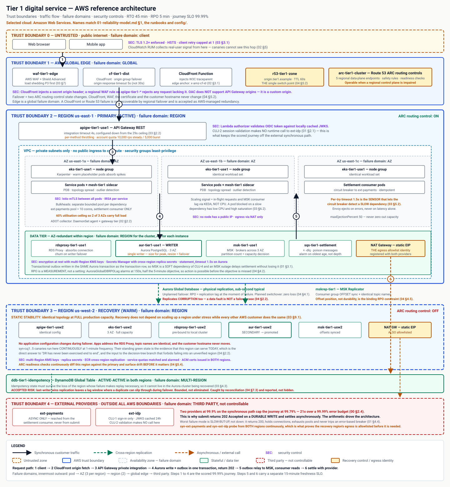

# Site Reliability Engineer Assessment

## Selected cloud: Amazon Web Services

AWS is used consistently throughout. No Azure services appear anywhere in this submission, and no hybrid dependency is proposed.

**Why AWS.** The scenario describes the reference workload in AWS terms, so selecting AWS means the effort goes into provider-specific behaviour and trade-offs rather than into translation. The brief states that a simple service-name substitution is insufficient, and that bar is easier to clear honestly on the platform the scenario is written in. Every service choice below is accompanied by the behaviour that justifies it and the cost or risk it carries.

**Author:** Muhammad Hafizi Yahaya
**Date:** 23 November 2026

---

## The two findings that shaped everything else

The brief gives six tasks and a set of constraints. Two of the constraints cannot all hold as written, and the arithmetic is in [`00-scope-assumptions.md`](00-scope-assumptions.md). Both findings drove architectural decisions rather than being noted and set aside.

**1. The 45-minute RTO exceeds the entire error budget by a factor of ten.**

```
99.99% over 30 days  =  4.32 minutes of permitted downtime
45-minute RTO        =  10.4 months of error budget, consumed in one event
```

A 99.99 percent target and a manual 45-minute regional recovery describe two different funding levels. Resolved with a **bounded disaster clause**, where minutes beyond 45 still count against the budget so the clause cannot become a blank cheque, and with active-active as the funded 90-day direction.

**2. Two external providers on the synchronous path cap the journey at 99.79 percent.**

```
0.9999 x 0.999 x 0.999  =  99.79%  =  90.7 minutes per 30 days
                                    =  21x the available error budget
```

The target is unreachable by arithmetic, not by effort. **This is why submit returns `202 Accepted` on a durable write and settles asynchronously**, and why first sign-in is separated from session validation. The arithmetic drove the architecture rather than decorating it.

---

## Mandatory architecture diagram



Shows trust boundaries (5 nested zones), traffic flow (numbered request path 1 to 6), failure domains (pod, AZ, region, global edge, third party), security controls (marked `SEC:`) and key service names. Every name matches [`01-reliability-model.md`](01-reliability-model.md) section 1, the runbooks and the files in `config/` and `slo/`.

*If the SVG does not render in your viewer, open [`diagrams/architecture.svg`](diagrams/architecture.svg) directly.*

---

## Contents

| | Document | Task | Weight |
|---|---|---|---|
| 0 | [Scope, assumptions and exclusions](00-scope-assumptions.md) | Gate | — |
| 1 | [Service reliability model](01-reliability-model.md) | Reliability model | 20% |
| 2 | [Observability architecture](02-observability.md) | Observability | 15% |
| 3 | [Resilience engineering](03-resilience.md) | Resilience | 20% |
| 4 | [Regional recovery](04-regional-recovery.md) | Regional recovery | 20% |
| 5 | [Incident command model](05-incident-command.md) | Incident command | 15% |
| 6 | [Programme roadmap, metrics and governance](06-roadmap-90day.md) | Program roadmap | 10% |
| 7 | [Validation and known limitations](07-validation-limitations.md) | Gate | — |

### Supporting artefacts

| File | Purpose |
|---|---|
| [`runbooks/dr-regional-failover.md`](runbooks/dr-regional-failover.md) | Executable failover runbook, written to be run under pressure by someone who did not write it |
| [`runbooks/game-day-plan.md`](runbooks/game-day-plan.md) | L1 to L5 exercise ladder with hypotheses, abort criteria and automated stop conditions |
| [`slo/slo-spec.yaml`](slo/slo-spec.yaml) | Machine-readable SLI/SLO specification |
| [`slo/burn-rate-alarms.tf`](slo/burn-rate-alarms.tf) | CloudWatch multi-window burn-rate alarms, hard-down fast path, RPO monitors |
| [`config/istio-outlier-detection.yaml`](config/istio-outlier-detection.yaml) | Circuit breaking, bulkheads, retry budget, timeout ladder |
| [`config/msk-consumer.properties`](config/msk-consumer.properties) | Settlement consumer, backpressure, poison-message handling, controlled drain |
| [`config/idempotency-table.tf`](config/idempotency-table.tf) | DynamoDB Global Table, multi-Region KMS |

### Suggested reading order

Short on time, read these three: [`00-scope-assumptions.md`](00-scope-assumptions.md) for the arithmetic that drives everything, the diagram above, and [`07-validation-limitations.md`](07-validation-limitations.md) for what is unproven.

---

## Required deliverables

| Required | Where |
|---|---|
| Service reliability model | [`01`](01-reliability-model.md) sections 1 to 4 |
| SLI/SLO specification | [`01`](01-reliability-model.md) sections 5 to 6, [`slo/slo-spec.yaml`](slo/slo-spec.yaml) |
| Observability and resilience architecture | [`02`](02-observability.md), [`03`](03-resilience.md), `config/` |
| DR runbook and game-day plan | [`runbooks/`](runbooks/), designed in [`04`](04-regional-recovery.md) sections 1 to 8 and 10 |
| Incident command model | [`05`](05-incident-command.md) |
| Prioritised 90-day roadmap | [`06`](06-roadmap-90day.md) sections 2 to 3 |
| Mandatory architecture diagram | [`diagrams/architecture.svg`](diagrams/architecture.svg), embedded above |

## Submission checklist

| Item | Where |
|---|---|
| Selected cloud stated and used consistently | Top of this file, and the header of every section |
| Architecture diagram included and readable | Embedded above, 1440x1560, legend included |
| Assumptions and exclusions explicit | [`00`](00-scope-assumptions.md) sections 3 and 4, with an "if wrong" column on every assumption |
| Diagrams and code use consistent names | [`01`](01-reliability-model.md) section 1 is the naming authority. `slo/` and `config/` use the same names and cross-reference back. |
| Security addressed | Diagram `SEC:` annotations, [`01`](01-reliability-model.md) section 2.1, [`04`](04-regional-recovery.md) section 6, `config/` |
| Reliability addressed | [`01`](01-reliability-model.md) to [`04`](04-regional-recovery.md) |
| Cost addressed | [`02`](02-observability.md) section 7.2, [`03`](03-resilience.md) section 9.1, [`04`](04-regional-recovery.md) section 5.6. Unit prices excluded, with reasons, at [`00`](00-scope-assumptions.md) E1. |
| Operational ownership addressed | [`01`](01-reliability-model.md) section 7, [`06`](06-roadmap-90day.md) sections 4.1 and 4.5 |
| Validation steps included | [`07`](07-validation-limitations.md) section 1, 24 controls with pass criteria |
| Known limitations included | [`07`](07-validation-limitations.md) section 3, 14 limitations |
| Sources and AI assistance disclosed | Below |

---

## Scenario symptoms, and where each is answered

The brief states four problems. Each is traced to a specific mechanism rather than to a general improvement.

| Symptom | Diagnosis | Answer |
|---|---|---|
| Many alerts, slow detection | Alerting on **causes**, not symptoms. Causes are numerous, fire for things customers never notice, and cannot detect novel failures. | Only journey-level symptom alerts page. Cause signals are demoted, not deleted. [`02`](02-observability.md) section 1 and 8. |
| Retry storms caused two regional incidents | Retries were not the cause. **Generous timeouts** were. At a 29-second timeout, Little's Law gives 29,000 in-flight requests at 1,000 rps, and a 200-connection pool collapses to 6.9 rps of throughput with no errors reported anywhere. | Timeout ladder derived inward from the latency objective, per-try timeout as the circuit-breaker sensor, retry budgets, bulkheads. [`03`](03-resilience.md) sections 1 to 6. |
| DR never exercised end to end | Nothing continuously proves the recovery region can serve. | Canaries running continuously **from both regions**, ARC readiness checks, and an L1 to L5 game-day ladder whose L4 is the exit criterion for day 90. [`04`](04-regional-recovery.md) sections 5.4 and 10. |
| Teams disagree on who owns reliability | Delivery teams face **no consequence** for shipping unreliable software, so work flows to whoever is competent to absorb it. | An error budget policy with real consequences, attached to the team that owns the code. Everything else is supporting structure. [`06`](06-roadmap-90day.md) section 4.3. |

---

## Sources

### Primary, regulatory

Used in [`04`](04-regional-recovery.md) section 9. Figures stated there are consistent across these sources and corroborated by published enforcement actions. The paragraph reference is flagged for verification because RMiT was revised in late 2025.

- [BNM, Risk Management in Technology, policy document](https://www.bnm.gov.my/documents/20124/938039/pd-rmit-sep26.pdf) — paragraph 10.32 critical system downtime limits
- [BNM, RMiT FAQ](https://www.bnm.gov.my/documents/20124/938039/faq-pd-rmit-jul2026.pdf) — rolling 12-month tally worked example
- [BNM, administrative monetary penalty, Bank Simpanan Nasional](https://www.bnm.gov.my/-/eapn925) — enforcement precedent
- [BNM, Annual Report 2025, Promoting Financial Stability](https://www.bnm.gov.my/publications/ar2025/ch1b) — action against nine banks, RM5.6 million total
- [BNM, Operational Resilience discussion paper, December 2025](https://www.bnm.gov.my/documents/20124/938039/dp_operationalresilience_Dec2025.pdf)

### Technical practice

- Google, *The Site Reliability Workbook*, chapter 5 — multi-window multi-burn-rate alerting, the 14.4x / 6x / 3x / 1x windows used in [`02`](02-observability.md) section 8.2
- Google, *Site Reliability Engineering*, chapters 3 to 6 — error budgets, symptom-based alerting, the toil definition used in [`06`](06-roadmap-90day.md) section 1.2
- AWS Builders' Library, *Timeouts, retries and backoff with jitter* — full-jitter formula and retry budget reasoning in [`03`](03-resilience.md) section 3
- AWS Builders' Library, *Static stability using Availability Zones* — the static stability position in [`03`](03-resilience.md) section 9.1 and [`04`](04-regional-recovery.md) section 5.1
- AWS Builders' Library, *Using load shedding to avoid overload* — priority shedding and fast rejection in [`03`](03-resilience.md) section 7
- AWS Well-Architected Framework, Reliability Pillar — failure domain and recovery objective framing
- AWS service documentation — Aurora Global Database switchover versus failover semantics, MSK Replicator offset synchronisation, Route 53 ARC routing control data plane, API Gateway integration timeout quotas, CloudWatch metric retention tiers, FIS stop conditions
- Little's Law, applied in [`03`](03-resilience.md) section 1.2 to quantify the timeout and concurrency relationship

Where AWS behaviour is cited (quotas, retention windows, replication semantics), it reflects documented behaviour at the time of writing. Anything a reviewer would act on operationally should be re-checked against current documentation, since AWS quotas and defaults change.

---

## AI assistance disclosure

The brief requires this, so it is stated plainly rather than minimised.

**This submission was produced with AI assistance.** I used Anthropic's Claude as a drafting and research collaborator throughout, in a working session where I set the direction, made the decisions and reviewed the output.

**What the AI did:**
- Drafted and structured the prose across all sections
- Helped work through the arithmetic in [`00`](00-scope-assumptions.md), including the error-budget, dependency-chain and Little's Law calculations
- Researched the BNM RMiT requirements and surfaced the paragraph 10.32 limits
- Produced the first version of the SVG diagram and the configuration files

**What I did:**
- Set the scope, the approach and the cloud selection
- Supplied the operating context and the engineering judgement about which trade-offs are real in production
- Directed which design positions to take, including the asynchronous settlement decision, the bounded disaster clause and the decision not to automate failover
- Reviewed, corrected and accepted the content. I am accountable for all of it.

**Two things I want to be specific about, because they are the kind of detail this disclosure exists for:**

1. **A regulatory figure was nearly wrong.** An initial draft was going to cite a one-hour BNM incident notification deadline. Checking it against primary sources showed that figure is not supported, that published sources conflict, and that the genuinely verifiable requirement is a different one entirely. The submission therefore asserts no notification deadline and records the gap as an open action in [`07`](07-validation-limitations.md) L9. AI-assisted research needs verification against primary sources, and this is what that looks like in practice.

2. **A scoring model was corrected mid-draft.** The first version of the prioritisation formula in [`06`](06-roadmap-90day.md) multiplied by raw toil hours, which gave a 40-hour-per-month item a 40-fold multiplier and pushed every genuine reliability risk below routine automation. It is noted in section 1.1 as banded instead, because the broken version is informative about how the model behaves.

I am happy to discuss any part of this in detail, including the parts I would argue differently on reflection. The limitations in [`07`](07-validation-limitations.md) are the honest list, not a formality.
